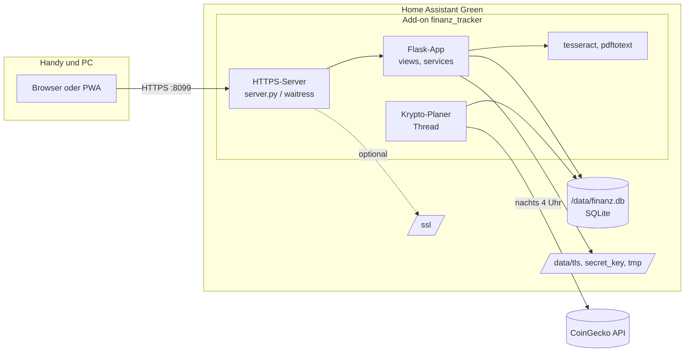

# Architektur

## Grundprinzip

- **Ein Prozess, eine Datei:** Ein Python-Prozess (Flask) bedient die Weboberfläche, alle Daten liegen in einer
  SQLite-Datei (`/data/finanz.db`).
- **Home Assistant ist nur Host:** Es gibt keine Integration in Home Assistant und keine Abhängigkeit vom
  Supervisor außer Optionen, `/ssl` und der Liste der Netzwerkadressen (für das Zertifikat). Siehe
  [ADR-0001](adr/0001-eigenstaendige-web-app-auf-home-assistant.md).
- **Kein Build-Schritt:** HTML entsteht serverseitig mit Jinja. JavaScript und CSS liegen als Dateien unter
  `static/`, ohne Framework und ohne Abhängigkeiten aus dem Internet
  ([ADR-0002](adr/0002-python-flask-sqlite-ohne-frontend-build.md),
  [ADR-0016](adr/0016-eigene-diagramm-bibliothek.md)).
- **Alles läuft lokal:** Auch Texterkennung (Tesseract) und PDF-Lesen (poppler) laufen auf dem Green. Ins Internet
  geht nur der Kursabruf für Krypto ([ADR-0013](adr/0013-krypto-kurse-von-coingecko.md)).



## Verzeichnisse

```
finanz-tracker-ha/
├── CLAUDE.md                 Arbeitsregeln für Claude Code
├── README.md                 Installation und Bedienung (für Benjamin)
├── repository.yaml           macht das Repository zum Add-on-Repository
├── docs/                     diese Dokumentation, ADRs
├── tools/                    einrichten.py, pruefen.py, release.py
└── finanz_tracker/           das Add-on
    ├── config.yaml           Add-on-Beschreibung, Version, Optionen, Port 8099 → 8080
    ├── build.yaml, Dockerfile, requirements.txt
    ├── DOCS.md, CHANGELOG.md, translations/
    ├── tests/                test_app.py, Beispieldateien (CSV, PDF)
    └── app/
        ├── __main__.py       Start: HTTPS vorbereiten, App bauen, Notfall-Passwort, Krypto-Planer, Server
        ├── __init__.py       create_app: Konfiguration, Migration, CSRF, Kontext, Filter, Blueprints
        ├── config.py         VERSION, Pfade, Login- und Umbuchungs-Konstanten
        ├── db.py             SQLite-Zugriff (q, q1, exe, commit), Migrationen, Einstellungen, Änderungslog
        ├── auth.py           Passwort-Hash (scrypt), Login-Sperre, Rollen, Kontosichtbarkeit
        ├── tls.py, server.py Heim-CA und Zertifikate, HTTPS-Server mit HTTP-Umleitung
        ├── util.py           Euro-Format, Eingabe-Parser, Monate, Partner-Schlüssel
        ├── migrations/       NNN_name.sql, beim Start eingespielt
        ├── services/         Fachlogik (ohne Flask-Request)
        ├── views/            Blueprints: Formulare, Weiterleitungen, Templates
        ├── templates/        Jinja-Vorlagen, dazu sw.js (Service Worker)
        └── static/           app.css, app.js, diagramme.js, dashboard.js, auswertung.js, icons/
```

## Schichten

| Schicht | Aufgabe | Regeln |
| --- | --- | --- |
| `views/` | HTTP: Parameter lesen, Rechte prüfen, Service aufrufen, `commit()`, Meldung, Weiterleitung oder Template | Eine Datei je Bereich, ein Blueprint mit eigenem URL-Präfix. Nach POST immer Weiterleitung (Post/Redirect/Get). |
| `services/` | Fachlogik und Berechnungen | Kein Zugriff auf `request`. Sichtbarkeit kommt als Liste von Konto-IDs herein. Kein `commit()`; das macht die View. |
| `db.py` | Datenbankzugriff | Reines SQL mit Parametern, keine ORM-Schicht. `sqlite3.Row`, Fremdschlüssel an. |
| `templates/` | Darstellung | Makros in `_makros.html` (CSRF, Kategorieauswahl, Personenauswahl …). |
| `static/` | Verhalten im Browser | Fortschreitende Verbesserung: Die Seite funktioniert ohne JavaScript, Diagramme und Komfort kommen dazu. |

Die Services nutzen sich gegenseitig, zum Beispiel `vermoegen` → `darlehen`, `bausparen`, `depot`, `krypto`.
Zentral sind:
- `statistik` mit `posten()` und `art_von()` als Rechengrundlage aller Kennzahlen
- `zuordnung` für die Automatik beim Import

## Ablauf einer Anfrage

1. `server.py` nimmt die Verbindung an. Beginnt sie nicht mit einem TLS-Handshake, wird mit 301 auf `https://`
   umgeleitet (gleicher Port).
2. `before_request`:
   - lädt den Benutzer aus der Sitzung
   - legt bei Bedarf das CSRF-Token an
   - prüft bei jedem POST das Token aus dem Formularfeld `csrf` oder dem Kopf `X-CSRF`
3. Die View prüft die Rechte mit einem Dekorator:
   - `login_required` für jede Seite
   - `schreibrecht` für Rolle Admin oder Mitglied
   - `admin_required` nur für Admins
4. Daten werden nur über Konten aus `auth.sichtbare_konten()` gelesen.
5. Der Kontextprozessor liefert jeder Vorlage:
   - Benutzer, Schreibrecht, Version
   - Zahl offener Prüfungen
   - Kündigungshinweise
6. Schreibende Aktionen protokolliert `log_aenderung` in `aenderungslog`.

## Hintergrundaufgaben

| Aufgabe | Wann | Wo |
| --- | --- | --- |
| Migrationen | bei jedem Start vor der ersten Anfrage | `db.migrate()` |
| Aufräumen `tmp/` (abgebrochene Import-Vorschauen, Zwischendateien) | beim Start, Dateien älter als ein Tag (außer Profil-Beispieldateien) | `_aufraeumen()` |
| Serverzertifikat erneuern bzw. an neue IPs anpassen | beim Start | `tls.bereite_vor()` |
| Krypto-Kurse | Thread prüft jede Minute; Abruf nachts ab 4 Uhr einmal täglich, nach Fehlschlag frühestens nach 30 Minuten | `krypto.starte_planer()` |
| Zuführungen zu Rücklagen | beim Öffnen von Dashboard und Sparseite (idempotent) | `ruecklagen.uebersicht()` → `buche_zufuehrungen()` |

Es gibt keine Warteschlange und keinen Worker. Aufwendige Schritte wie Import, Texterkennung und Zuordnung laufen
direkt in der Anfrage.

## Sicherheit

- **Anmeldung:**
  - Passwörter mit scrypt gehasht
  - nach 5 Fehlversuchen 15 Minuten Sperre je Benutzername
  - Sitzung 30 Tage, Cookie `HttpOnly`, `SameSite=Lax`, bei HTTPS `Secure`
- **Rollen:**
  - `admin`: alles, auch Verwaltung und alle privaten Konten
  - `mitglied`: lesen und schreiben, sieht gemeinsame und eigene private Konten
  - `lesend`: nur lesen
  - Siehe [ADR-0005](adr/0005-eigener-login-rollen-private-konten.md).
- **CSRF:** zufälliges Token je Sitzung, Pflicht bei jedem POST. JavaScript schickt es im Kopf `X-CSRF` mit.
- **Uploads:** höchstens 20 MB je Anfrage. Dateien liegen nur bis zum Übernehmen in `/data/tmp`.
- **Transport:** HTTPS mit Heim-CA oder dem Zertifikat aus `/ssl` ([ADR-0014](adr/0014-https-mit-heim-ca.md)).
  Der Port wird nicht im Router freigegeben; von unterwegs geht es nur über VPN.
- **Notfall:** Die Add-on-Option `admin_passwort_reset` setzt beim Start das Passwort des ersten Admins zurück.
- **Service Worker:** Er speichert nur CSS, JS, Symbole und die Offline-Seite, nie Finanzdaten
  ([ADR-0015](adr/0015-pwa-ohne-daten-im-cache.md)).

## Oberfläche

- **Kopfzeile:** fixiert. Hauptpunkte oben, Verwaltungsseiten unter „Mehr“.
- **Layout:** Karten (`.karte`) in Reihen (`.reihe`, breit/schmal); Kennzahlen als `.kpis`.
- **Farben:** nur über CSS-Variablen in `:root`. Das dunkle Schema setzt dieselben Variablen neu, entweder per
  `prefers-color-scheme` oder über `data-theme` am `<html>` ([ADR-0022](adr/0022-dunkles-farbschema.md)).
- **Diagramme:** `static/diagramme.js` zeichnet SVG mit Tooltip und Klickzielen. Unterstützt werden:
  - Säulen, gestapelte Säulen, waagerechte Balken
  - Linie, Fläche
  - Ring, Torte
  - Tabelle, Kennzahl, Wärmekarte
  - Sankey, Mini-Verlauf
- **Zustand der Oberfläche:** Ein- und ausgeklappte Bereiche, gewählte Zeiträume und Farbschema liegen je Gerät im
  `localStorage`, immer in `try/catch` ([ADR-0023](adr/0023-oberflaechenzustand-je-geraet.md)).
- **Handy:** Tabellen scrollen seitlich (`.scroll`). Ab 720 px Breite abwärts gelten kompakte Regeln.
