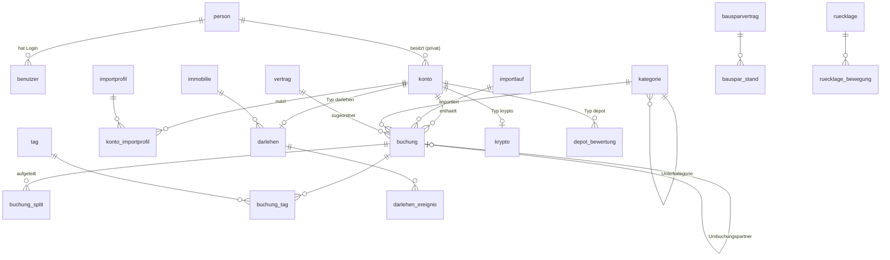

# Datenmodell

Die Datenbank ist eine SQLite-Datei: im Add-on `/data/finanz.db`, lokal `finanz_tracker/data/finanz.db`. Das Schema
entsteht ausschließlich aus den Migrationen unter `finanz_tracker/app/migrations/`
([ADR-0003](adr/0003-versionierte-sql-migrationen.md)). Diese Übersicht beschreibt den Stand nach Migration 009.

## Konventionen

| Was | Regel |
| --- | --- |
| Beträge | Immer ganze Cent als `INTEGER`, Spaltenname endet auf `_cent`. Abbuchung negativ, Gutschrift positiv ([ADR-0004](adr/0004-betraege-in-cent-und-abrechnungsmonat.md)). |
| Datum | ISO-Text `YYYY-MM-DD`; Zeitpunkte `YYYY-MM-DD HH:MM:SS` (`datetime('now')`, UTC). |
| Monat | Text `YYYY-MM` (z. B. `abrechnungsmonat`, `monat`). |
| Zinssätze | Prozent als `REAL` (z. B. `sollzins = 3.45`). Tilgungsbeitrag beim Bausparen in Promille. |
| Wahrheitswerte | `INTEGER` 0/1 (`aktiv`, `geprueft`, `ist_umbuchung` …). |
| JSON | Als Text in einzelnen Spalten: `regel.bedingungen`, `regel.aktionen`, `importprofil.einstellungen`, `importprofil.spalten`, `auswertung_ansicht.diagramme`, `buchung.rohdaten`, `aenderungslog.daten`. Lesen mit `db.jload`, schreiben mit `db.jdump`. |
| Fremdschlüssel | `PRAGMA foreign_keys = ON` im Betrieb, während Migrationen `OFF`. Löschverhalten steht an der Spalte (`CASCADE` bzw. `SET NULL`). |
| Namen | Deutsch, Kleinbuchstaben, Unterstriche. Tabellen im Singular. |

## Überblick

## Tabellen

### Stammdaten und Zugang

| Tabelle | Zweck | Wichtige Spalten |
| --- | --- | --- |
| `person` | Familienmitglied, auch ohne Login | `name`, `farbe`, `aktiv` |
| `benutzer` | Login | `name`, `passwort_hash` (scrypt), `rolle` ∈ admin/mitglied/lesend, `person_id`, `aktiv` |
| `einstellung` | Schlüssel-Wert-Paare | z. B. `sparquote_ziel`; je Benutzer `planung_auswahl:<id>`, `planung_sparrate:<id>` |
| `aenderungslog` | Wer hat wann was geändert | `benutzer_id`, `tabelle`, `datensatz_id`, `aktion`, `daten` (JSON) |
| `schema_version` | Stand der Migrationen | eine Zeile `version` |

### Konten und Import

| Tabelle | Zweck | Wichtige Spalten |
| --- | --- | --- |
| `konto` | Konto jeder Art | `typ` ∈ giro/tagesgeld/kreditkarte/bargeld/depot/darlehen/krypto/sonstiges, `iban`, `sichtbarkeit` ∈ alle/privat, `eigentuemer_person_id`, `startsaldo_cent`, `import_erinnerung_tage`, `aktiv`, `sortierung` |
| `importprofil` | CSV-Format einer Bank | `format`, `einstellungen` (Zeichensatz, Trennzeichen, Datums- und Dezimalformat), `spalten` (Index, Überschrift, Feld), `betrag_modus` ∈ vorzeichen/soll_haben/kennzeichen, `beispiel` |
| `konto_importprofil` | Profil je Konto | `rolle` ∈ buchungen/abgleich, `erkennungswert` (z. B. IBAN-Teil) |
| `importlauf` | Ein Import | `dateiname`, `datei_hash`, `anzahl_neu/_doppelt/_fehler`, `saldo_datei_cent`, `saldo_differenz_cent`, `rueckgaengig` |
| `buchung_geloescht` | Sperrliste gelöschter importierter Buchungen | `konto_id`, `dedup_hash` (eindeutig je Konto), Datum, Betrag, Gegenpartei, wer, wann ([ADR-0020](adr/0020-loeschen-mit-sperrliste.md)) |

### Buchungen

`buchung` ist die zentrale Tabelle.

| Spaltengruppe | Spalten | Bedeutung |
| --- | --- | --- |
| Herkunft | `konto_id`, `importlauf_id`, `dedup_hash`, `rohdaten`, `saldo_cent`, `manuell_erfasst`, `auto_gegenbuchung` | `dedup_hash`: CSV = SHA-256 aus Konto, Datum, Betrag, IBAN, Zweck, Gegenpartei und laufender Nummer; Screenshot/PDF = `ocr:…`; von Hand = `manuell:…`; automatische Gegenbuchung = `gegen:<id>` |
| Inhalt | `buchungsdatum`, `valuta`, `betrag_cent`, `gegenpartei`, `gegen_iban`, `verwendungszweck`, `partner_key`, `notiz` | `partner_key` = normalisierte Gegenpartei bzw. IBAN |
| Zuordnung | `kategorie_id`, `person_id`, `abrechnungsmonat`, `verteilung_monate` (1–60) | `abrechnungsmonat` entscheidet, in welchem Monat die Buchung zählt |
| Automatik | `zuordnung_quelle` ∈ regel/gedaechtnis/modell/manuell/umbuchung, `regel_id`, `konfidenz`, `vorschlag_kategorie_id`, `geprueft` | ungeprüfte automatische Zuordnungen erscheinen im Prüf-Modus |
| Umbuchung | `ist_umbuchung`, `umbuchung_partner_id`, `umbuchung_konto_id` | Partner = verknüpfte Gegenbuchung; Gegenkonto auch ohne Partner (wartet auf Import) |
| Bezüge | `ruecklage_id`, `vertrag_id`, `darlehen_konto_id` | bezahlt aus Rücklage; zugeordneter Vertrag; Zahlung an ein Darlehen |

| Tabelle | Zweck |
| --- | --- |
| `buchung_split` | Teile einer Buchung mit `betrag_cent`, `kategorie_id`, `person_id`, `notiz`. Die Summe muss dem Buchungsbetrag entsprechen. |
| `tag`, `buchung_tag` | Tags mit optionalem Zeitraum (`start`, `ende`) und `budget_cent`; n:m zu Buchungen |
| `umbuchung_vorschlag` | Erkannte Paare (`buchung_a_id`, `buchung_b_id`, `score`, `status` ∈ offen/abgelehnt) |
| `zuordnung_feedback` | War die automatische Zuordnung richtig? Grundlage der Trefferquote je Quelle |

### Ordnung und Automatik

| Tabelle | Zweck | Wichtige Spalten |
| --- | --- | --- |
| `kategorie` | Baum beliebiger Tiefe | `parent_id`, `name`, `pfad` (z. B. „Mobilität › Autos › Peugeot“), `ebene`, `art` ∈ einnahme/ausgabe/umbuchung oder NULL = vom Elternteil erben |
| `regel` | Automatische Zuordnung | `prioritaet`, `aktiv`, `bedingungen` (JSON-Liste), `aktionen` (JSON) |

Bedingungen einer Regel:
- `gegenpartei`, `verwendungszweck`, `gegen_iban` mit enthält / gleich / beginnt mit / regulärer Ausdruck
- `betrag` mit min / max / gleich
- `richtung` (Eingang oder Ausgang)
- `konto`
- `tag` im Monat (ab / bis)

Aktionen einer Regel:
- Kategorie, Person, Tag setzen
- Monatsversatz
- Verteilung über Monate
- als Umbuchung mit Gegenkonto markieren

### Planen und Sparen

| Tabelle | Zweck | Wichtige Spalten |
| --- | --- | --- |
| `budget` | Budget je Kategorie, optional je Person | `betrag_cent`, `rhythmus` ∈ monat/jahr, `gueltig_ab`, `uebertrag`, `warnschwelle` |
| `ruecklage` | Rücklage oder Sparziel | `traeger_konto_id`, `bezug` ∈ topf/konto, `ziel_cent`, `zieldatum`, `zufuehrung_cent`, `start_monat` |
| `ruecklage_bewegung` | Bewegungen einer Rücklage | `art` ∈ zufuehrung/entnahme/korrektur, `monat`, `buchung_id` |
| `vertrag` | Abo, Fixkosten, Vertrag | `art` ∈ abo/fix/vertrag/ignoriert, `partner_key`, `betrag_cent`, `rhythmus_monate` (0 = unregelmäßig), `beginn`, `laufzeit_ende`, `verlaengerung_monate`, `kuendigungsfrist` + `_einheit`, `gekuendigt_zum` |
| `plan_posten` | Geplante Ausgabe oder Sondereinnahme | `art` ∈ ausgabe/einnahme, `name`, `betrag_cent` (≥ 0), `monat`, `kategorie_id`, `erledigt` |
| `auswertung_ansicht` | Gespeicherte eigene Auswertungen je Benutzer | `name`, `sortierung`, `diagramme` (JSON) |

`art = 'ignoriert'` in `vertrag` blendet eine Gegenpartei dauerhaft aus den erkannten regelmäßigen Zahlungen aus.

### Vermögen und Schulden

| Tabelle | Zweck | Wichtige Spalten |
| --- | --- | --- |
| `darlehen` | Konditionen eines Darlehenskontos (1:1 zu `konto`) | `ursprung_cent`, `sollzins`, `rate_cent`, `erste_rate`, `zinsbindung_bis`, `sondertilgung_prozent`, `sondertilgung_max_cent`, `zahlkonto_id`, `erinnerung_monate`, `anschluss_sollzins`, `anschluss_rate_cent`, `immobilie_id` |
| `darlehen_ereignis` | Sondertilgung oder Abgleich mit der Bank | `art` ∈ sondertilgung/abgleich, `datum`, `betrag_cent`, `buchung_id` (Buchung im Darlehenskonto), `zahlung_buchung_id` (Abbuchung im Zahlkonto) |
| `immobilie` | Objekt zu Darlehen | `kaufpreis_cent`, `kaufdatum`, `wert_cent`, `wert_datum` |
| `bausparvertrag` | Bausparvertrag (kein Konto) | `bausparsumme_cent`, `beginn`, `sparrate_cent`, `guthabenzins`, `darlehenszins`, `tilgungsbeitrag_promille`, `mindestguthaben_prozent`, `zuteilung_gewuenscht`, `darlehen_konto_id` (abzulösendes Darlehen) |
| `bauspar_stand` | Guthaben laut Kontoauszug | `datum`, `guthaben_cent` |
| `depot_bewertung` | Rendite eines Depots | `datum`, `einheit` ∈ prozent/betrag, `wert` (Hundertstel-Prozent bzw. Cent) |
| `krypto` | Bestand eines Krypto-Kontos | `coin` ∈ bitcoin/ethereum, `menge`, `einstand_cent`, `im_vermoegen` |
| `krypto_kurs` | Ein Kurs je Coin und Tag | `coin`, `datum`, `preis_cent` |

## Sichten

| Sicht | Inhalt |
| --- | --- |
| `posten` | Eine Zeile je Buchung ohne Aufteilung bzw. je Teil einer Aufteilung. Person des Teils, sonst der Buchung. |
| `posten_monat` | `posten` je Monat: Bei `verteilung_monate = n` entstehen n Zeilen mit `betrag_cent / n`; der Rundungsrest liegt im ersten Monat. Spalten `monat` und `betrag_monat`. |

Alle Kennzahlen (Dashboard, Budgets, Auswertung, Sparen, Cashflow) rechnen über `statistik.posten()` auf
`posten_monat`. Dabei gilt:
- Umbuchungen (`ist_umbuchung = 1`) zählen nie.
- Darlehenskonten zählen nie in Einnahmen und Ausgaben ([ADR-0010](adr/0010-darlehen-getrennt-vom-haushalt.md)).
- Die Art (Einnahme/Ausgabe) kommt aus der wirksamen Art der Kategorie.
- Unkategorisierte Eingänge gelten als Einnahme, unkategorisierte Abgänge als Ausgabe.

## Migrationen

| Nr. | Version | Inhalt |
| --- | --- | --- |
| 001 | 0.1.0 | Grundschema: Benutzer, Personen, Konten, Importprofile, Importläufe, Kategorien, Regeln, Buchungen, Umbuchungsvorschläge, Einstellungen, Änderungslog |
| 002 | 0.2.0 | Aufteilungen, Verteilung, Tags, Budgets, Rücklagen, Darlehen, Immobilien, Lernmodell-Feedback, Sichten `posten`/`posten_monat` (Neuaufbau von `buchung`) |
| 003 | 0.3.0 | `buchung.umbuchung_konto_id` |
| 004 | 0.3.1 | `buchung.auto_gegenbuchung`, nachträgliche Gegenbuchungen ins Barkonto |
| 005 | 0.4.0 | `depot_bewertung`, nachträgliche Gegenbuchungen ins Depot |
| 006 | 0.5.0 | Sondertilgung mit Buchung, `bausparvertrag`, `bauspar_stand` |
| 007 | 0.6.0 | `vertrag` als Datensatz (Übernahme alter Markierungen), `buchung.vertrag_id`, `buchung.darlehen_konto_id`, `auswertung_ansicht` |
| 008 | 0.7.0 | Kontotyp `krypto` (Neuaufbau `konto`), `krypto`, `krypto_kurs`, Darlehen: `sondertilgung_max_cent`, Anschlusskonditionen |
| 009 | 0.9.0 | `buchung_geloescht`, `plan_posten` |

Neue Migrationen bekommen die nächste freie Nummer. Bestehende Migrationen werden nie geändert, denn installierte
Datenbanken haben sie schon eingespielt. Eine CHECK-Bedingung ändert man in SQLite nur über einen Neuaufbau der
Tabelle (Beispiel: 008).
